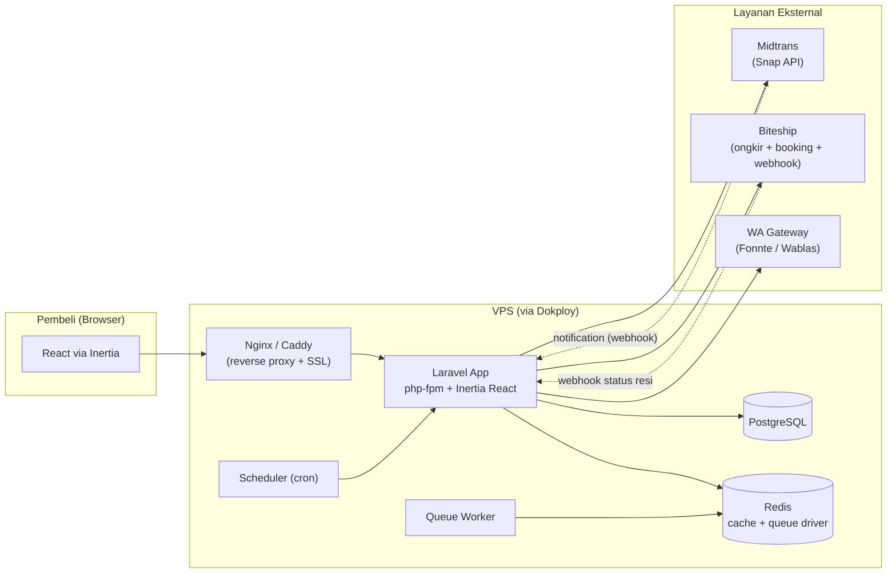
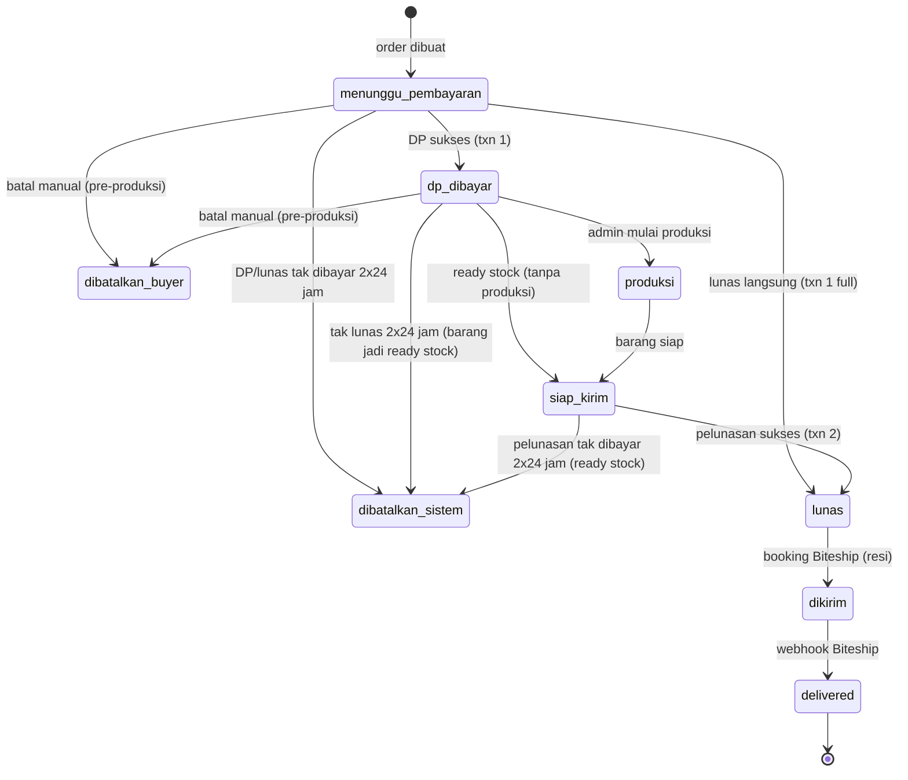

# Traz Cloth — Dokumen Perencanaan Sistem Toko Online Pre-Order

> **Status:** Perencanaan — disetujui 13 Agu 2026
> **Lingkup:** Toko online clothing berbasis pre-order / limited drop (kaos desain bergilir per periode)
> **Folder:** `/Users/ryansutrisno/Documents/Code/traz-cloth` (kosong, akan di-scaffold)

---

## 1. Ringkasan Eksekutif

Sistem adalah **toko online kaos pre-order limited edition**. Setiap kampanye (desain) memiliki **kuota global** (contoh 100 pcs untuk semua ukuran) dan **tanpa deadline waktu** — kampanye tutup otomatis saat kuota habis (sold out). Pembeli wajib akun, memilih **DP 50% atau langsung lunas** saat checkout, pembayaran via **Midtrans**, pengiriman via **Biteship** (ongkir real-time + resi otomatis + webhook status), reminder pelunasan via **WhatsApp**, dan **DP hangus total** jika batal.

Teknologi: **Laravel monolith + Inertia.js + React + TanStack**, **PostgreSQL**, deploy **Docker via Dokploy** ke VPS.

---

## 2. Keputusan Bisnis (Hasil Grilling — 25 Poin Terkunci)

### A. Model Bisnis & Kampanye
| # | Keputusan |
|---|-----------|
| 1 | Pre-order limited drop, desain bergilir tiap periode, **kuota global** (mis. 100 pcs per desain, mencakup semua ukuran), tanpa deadline waktu |
| 2 | **Sold-out saat DP berhasil** (slot terkunci saat DP). Kuota balik otomatis saat order batal. Anti-overselling |
| 3 | Ukuran standar **S–XXL**; admin mencentang ukuran tersedia per kampanye |
| 4 | **Harga hybrid**: aturan otomatis per size (base + penyesuaian size + surcharge XXL+ Rp5.000 + biaya press sablon Rp5.000), admin bisa override harga per size per kampanye |

### B. Alur Order & Pembayaran
| # | Keputusan |
|---|-----------|
| 5 | **DP minimal 50%** via Midtrans Snap (transaksi ke-1) → reservasi slot |
| 6 | Checkout **mode pilihan**: DP dulu ATAU langsung lunas (diterapkan juga untuk ready stock) |
| 7 | **Tenggat pelunasan 2×24 jam (2 hari)** — konsisten untuk pembayaran DP dan pelunasan setelah barang siap kirim |
| 8 | **2× reminder WA**: jam ke-12 dan jam ke-40 → auto-cancel di H+2 |
| 9 | **DP hangus total** jika batal (0% refund). Warning transparan di halaman produk ("DP hangus jika batal") |
| 10 | **Batal manual hanya sebelum produksi**; status dibedakan "dibatalkan buyer" vs "dibatalkan sistem" |
| 11 | **Pelunasan = transaksi Midtrans ke-2** (link baru dikirim saat barang siap kirim) |

### C. Logistik & Komunikasi
| # | Keputusan |
|---|-----------|
| 12 | **Biteship**: cek ongkir real-time saat checkout, booking kurir otomatis (resi auto), webhook status sampai `delivered` → kuota final & order selesai |
| 13 | **WhatsApp** untuk reminder pelunasan & update status (Fonnte / Wablas / WA Business API) |
| 14 | **Ready stock** dari order batal: dijual di halaman kampanye yang sama, harga sama, ready-to-ship, hanya ukuran yang sesuai dengan barang batal |

### D. Teknologi & Platform
| # | Keputusan |
|---|-----------|
| 15 | **Laravel monolith + Inertia.js + React + TanStack** (satu codebase; bisa dipecah BE/FE saat bisnis besar) |
| 16 | **PostgreSQL** (JSON handling webhook, enum, transaksi kompleks) |
| 17 | **Akun wajib** untuk buyer: nama, email, no WA, verifikasi **OTP WA** (sekaligus validasi nomor) |
| 18 | **2 role admin**: Admin (pemilik — full akses + laporan keuangan/profit) & Operator (kelola kampanye & order, tanpa laporan profit) |
| 19 | **Admin dashboard 5 area**: kampanye, order & status, komunikasi buyer, laporan keuangan, ready stock |
| 20 | **Storefront 5 area**: daftar kampanye + detail produk, keranjang, riwayat order, halaman statis, pencarian & filter |
| 21 | **Deploy via Dokploy (Docker)** ke VPS — Dockerfile + docker-compose (app, queue worker, scheduler, DB) |
| 22 | **2× WA reminder** (lihat #8) — dijadwalkan via Laravel scheduler |
| 23 | Kuota terpakai **saat DP berhasil** (lihat #2) |
| 24 | Ukuran standar S–XXL (lihat #3) |
| 25 | **Akun Midtrans & Biteship sudah tersedia** (kredensial asli, bukan sandbox) |

---

## 3. Arsitektur Sistem

### 3.1 Diagram Arsitektur



### 3.2 Komponen Utama

1. **Laravel App** — melayani semua request (storefront, admin, webhook). Rendering React via Inertia.
2. **Queue Worker** — memproses job async: kirim WA, sync status Biteship/Midtrans, dll.
3. **Scheduler** — cron di dalam container: auto-cancel, reminder WA, pengecekan status pembayaran.
4. **PostgreSQL** — penyimpanan utama.
5. **Redis** — antrian job + cache session/rate limit.
6. **Dokploy** — build image Docker, deploy, reverse proxy + SSL otomatis.

### 3.3 Alur End-to-End (Order Pre-Order Mode DP)

```
1. Buyer login (akun wajib, OTP WA)
2. Lihat halaman kampanye → pilih ukuran → tambah ke keranjang
3. Checkout:
   a. Pilih alamat pengiriman
   b. Cek ongkir real-time via Biteship → pilih kurir/layanan
   c. Pilih mode: DP 50% atau Lunas langsung
4. Pembayaran via Midtrans Snap (transaksi 1)
   ├─ SUCCESS DP → slot kuota terkunci (sold_count+1)
   │             → status: dp_dibayar
   │             → scheduler: reminder WA jam ke-12 & ke-40
   │             → jika tak lunas dalam 2×24 jam → auto-cancel (dibatalkan sistem), kuota balik
   │             → jika batal manual sebelum produksi → kuota balik
   └─ SUCCESS Lunas → status: lunas → produksi
5. Admin mulai produksi → status: produksi
6. Barang siap → admin tandai siap_kirim → status: siap_kirim
   → WA reminder pelunasan dikirim → buyer bayar via Midtrans (transaksi 2)
   → sukses → status: lunas
   → jika tak bayar 2×24 jam → auto-cancel → item balik jadi ready stock
7. Booking kurir via Biteship (resi otomatis) → status: dikirim
8. Webhook Biteship status delivered → status: delivered → order selesai
```

### 3.4 State Machine Order



**Status order (enum `OrderStatus`):**
`menunggu_pembayaran`, `dp_dibayar`, `produksi`, `siap_kirim`, `lunas`, `dikirim`, `delivered`, `dibatalkan_buyer`, `dibatalkan_sistem`

**Catatan penting:**
- Kuota bertambah (`sold_count--`) hanya saat status masuk `dibatalkan_buyer` / `dibatalkan_sistem`.
- Item yang dibatalkan dari status `siap_kirim`/`produksi` menjadi **ready stock** (qty ditambahkan ke `campaign_sizes.stock`).
- Semua transisi status wajib dicatat di tabel `order_status_histories` (audit trail).

---

## 4. Skema Database (PostgreSQL)

### 4.1 Daftar Tabel

| Tabel | Fungsi |
|-------|--------|
| `users` | Pembeli (buyer) |
| `admins` | Staf/admin (2 role) |
| `otp_codes` | Kode OTP verifikasi WA |
| `addresses` | Alamat pengiriman buyer |
| `campaigns` | Kampanye/desain (kuota, harga dasar, status) |
| `campaign_sizes` | Ukuran per kampanye (harga override, stok ready, enabled) |
| `cart_items` | Keranjang belanja |
| `orders` | Header order (status, mode bayar, total, resi) |
| `order_items` | Baris detail order (kampanye, size, qty, harga) |
| `order_status_histories` | Audit trail perubahan status |
| `payments` | Transaksi pembayaran (DP & pelunasan via Midtrans) |
| `wa_messages` | Outbox/log pesan WA |
| `webhook_logs` | Log webhook Midtrans/Biteship (idempotency) |

### 4.2 Detail Kolom Kunci

**`campaigns`**
```sql
id            bigint PK
slug          varchar UNIQUE
title         varchar            -- nama desain/kampanye
description   text
image_url     varchar
base_price    numeric(12,2)      -- harga dasar (size M dianggap base)
quota         int                -- kuota global (mis. 100)
sold_count    int DEFAULT 0      -- jumlah DP sukses aktif
status        enum('draft','active','sold_out','disabled')
ready_stock_enabled boolean DEFAULT true
created_at, updated_at
```

**`campaign_sizes`** (per ukuran per kampanye)
```sql
id            bigint PK
campaign_id   bigint FK
size          enum('S','M','L','XL','XXL')
price_override numeric(12,2) NULL  -- NULL = pakai aturan otomatis
stock         int DEFAULT 0        -- ready stock dari order batal
enabled       boolean DEFAULT true
UNIQUE(campaign_id, size)
```

**`orders`**
```sql
id                bigint PK
order_number      varchar UNIQUE     -- TRAZ-YYYYMMDD-XXXX
user_id           bigint FK
status            enum (lihat §3.4)
payment_mode      enum('dp','full')
subtotal          numeric(12,2)      -- harga barang
shipping_cost     numeric(12,2)
admin_fee         numeric(12,2) DEFAULT 0
total_amount      numeric(12,2)
dp_amount         numeric(12,2) NULL -- 50% (mode dp)
balance_amount    numeric(12,2) NULL
address_id        bigint FK
courier_code      varchar NULL       -- dari Biteship
courier_service   varchar NULL
resi_number       varchar NULL
biteship_order_id varchar NULL
timestamps:
  dp_paid_at, production_started_at, ready_at,
  pelunasan_deadline_at, lunas_at, shipped_at, delivered_at,
  cancelled_at
cancel_source     enum('buyer','system') NULL
cancel_reason     varchar NULL
```

**`payments`**
```sql
id              bigint PK
order_id        bigint FK
type            enum('dp','pelunasan','full')
midtrans_order_id varchar
midtrans_transaction_id varchar
amount          numeric(12,2)
status          enum('pending','paid','failed','expired')
payment_method  varchar NULL
raw_payload     jsonb NULL
paid_at         timestamptz NULL
UNIQUE(midtrans_order_id)
```

**`order_items`**
```sql
id          bigint PK
order_id    bigint FK
campaign_id bigint FK
size        enum
qty         int
unit_price  numeric(12,2)
```

**`users`**
```sql
id              bigint PK
name            varchar
email           varchar UNIQUE
phone           varchar UNIQUE       -- no WA
phone_verified_at timestamptz NULL
password        varchar
created_at, updated_at
```

**`admins`**
```sql
id       bigint PK
name     varchar
email    varchar UNIQUE
password varchar
role     enum('admin','operator')    -- operator tanpa laporan profit
```

**`addresses`**
```sql
id, user_id FK, label, recipient_name, phone,
province, city, district, subdistrict, postal_code,
full_address, is_default
```

**`wa_messages`** (outbox)
```sql
id, order_id FK NULL, phone, template_key,
payload jsonb, status enum('queued','sent','failed'),
error varchar NULL, sent_at timestamptz NULL
```

**`webhook_logs`**
```sql
id, provider enum('midtrans','biteship'), event varchar,
payload jsonb, processed boolean, error varchar NULL
-- idempotency: cek unique (provider, event_id) sebelum proses
```

### 4.3 Aturan Harga Otomatis per Size

```
harga_efektif(size) = base_price
                   + penyesuaian_size(size)        -- mis. S -5000, M 0, L 0, XL +5000, XXL +10000
                   + (size dalam {XL, XXL} ? +5000 : 0)   -- surcharge ukuran besar
                   + 5000                              -- biaya press sablon
```
- `penyesuaian_size` dikonfigurasi di setting admin (angka default awal, bisa diubah).
- Jika `campaign_sizes.price_override` terisi → pakai nilai tersebut (override).

---

## 5. Struktur Direktori (Laravel + Inertia React)

```
traz-cloth/
├── app/
│   ├── Console/
│   │   └── Commands/
│   │       ├── AutoCancelUnpaidOrders.php      # DP & pelunasan lewat tenggat
│   │       ├── SendPaymentReminders.php        # WA jam ke-12 & ke-40
│   │       ├── SyncBiteshipStatus.php          # fallback tarik status resi
│   │       ├── SyncMidtransPayments.php        # fallback cek status pembayaran
│   │       └── CheckCampaignSoldOut.php        # auto-disable kampanye
│   ├── Enums/
│   │   ├── OrderStatus.php
│   │   ├── PaymentType.php
│   │   ├── PaymentStatus.php
│   │   ├── CampaignStatus.php
│   │   └── Size.php
│   ├── Models/
│   │   ├── User.php, Admin.php, OtpCode.php
│   │   ├── Campaign.php, CampaignSize.php
│   │   ├── CartItem.php, Address.php
│   │   ├── Order.php, OrderItem.php, OrderStatusHistory.php
│   │   ├── Payment.php, WaMessage.php, WebhookLog.php
│   ├── Services/
│   │   ├── OrderService.php        # state machine & transisi status
│   │   ├── PricingService.php      # aturan harga hybrid
│   │   ├── QuotaService.php        # lock kuota, anti-overselling
│   │   ├── MidtransService.php     # Snap, status, webhook handling
│   │   ├── BiteshipService.php     # ongkir, booking, webhook
│   │   ├── WhatsAppService.php     # template & kirim WA
│   │   └── OtpService.php          # generate & verifikasi OTP
│   ├── Jobs/
│   │   ├── SendWhatsAppMessage.php
│   │   ├── ProcessMidtransNotification.php
│   │   ├── ProcessBiteshipWebhook.php
│   │   └── SyncBiteshipStatus.php
│   ├── Http/
│   │   ├── Controllers/
│   │   │   ├── Storefront/  (CampaignController, CartController,
│   │   │   │                CheckoutController, OrderController,
│   │   │   │                AccountController, PageController)
│   │   │   ├── Admin/       (DashboardController, CampaignAdminController,
│   │   │   │                OrderAdminController, CommunicationController,
│   │   │   │                ReportController, ReadyStockController)
│   │   │   └── Webhook/     (MidtransWebhookController, BiteshipWebhookController)
│   │   └── Middleware/      (IsAdmin, IsOperator, VerifiedPhone)
│   └── Notifications/       (WA templates: pelunasan_reminder, order_status, dst)
├── database/
│   ├── migrations/          (semua tabel §4)
│   └── seeders/             (admin awal, size default, penyesuaian harga)
├── resources/js/
│   ├── Pages/
│   │   ├── Storefront/      (Home, CampaignShow, Cart, Checkout,
│   │   │                    Orders, OrderShow, Account, About, Faq, Contact)
│   │   └── Admin/           (Dashboard, Campaigns, CampaignForm, Orders,
│   │                        OrderShow, Communications, Reports, ReadyStock)
│   ├── Components/
│   ├── Hooks/               (TanStack Query hooks)
│   └── app.jsx
├── routes/
│   ├── web.php              # storefront
│   ├── admin.php            # prefix /admin
│   └── webhook.php          # webhook tanpa CSRF, verifikasi signature
├── Dockerfile
├── docker-compose.yml       # app, worker, scheduler, db, redis
└── phpunit.xml / tests/
```

**Container Docker (docker-compose):**
- `app` — php-fpm + Inertia React (build assets)
- `worker` — `php artisan queue:work` (Redis)
- `scheduler` — `php artisan schedule:work` (menjalankan cron Laravel)
- `db` — PostgreSQL
- `redis` — cache + queue

---

## 6. Scheduler & Queue

### 6.1 Jadwal (Laravel Scheduler, berjalan setiap menit)

| Frekuensi | Job | Logika |
|-----------|-----|--------|
| Tiap menit | `SendPaymentReminders` | Cek order `menunggu_pembayaran` (DP) & `siap_kirim` (pelunasan): kirim WA reminder 1 di jam ke-12, reminder 2 di jam ke-40 |
| Tiap menit | `AutoCancelUnpaidOrders` | Order melewati 2×24 jam tanpa bayar → batal otomatis; item kembali ke kuota / ready stock |
| Tiap menit | `CheckCampaignSoldOut` | `sold_count >= quota` → status kampanye `sold_out` + badge |
| Tiap 15 menit | `SyncMidtransPayments` | Fallback: tarik status transaksi pending dari Midtrans (webhook bisa gagal) |
| Tiap 15 menit | `SyncBiteshipStatus` | Fallback: tarik status resi dari Biteship |

### 6.2 Anti-Idempotency & Konsistensi

- **Webhook** → verifikasi signature → simpan `webhook_logs` → proses via queue (retry).
- **Update status order** hanya via `OrderService::transition()` dengan **DB transaction + row lock** (`lockForUpdate`) untuk mencegah race condition (kuota, double-cancel).
- Kuota decrement/increment dilakukan di dalam transaksi yang sama dengan perubahan status.
- **Notifikasi Midtrans** menggunakan `transaction_status` sebagai sumber kebenaran: `capture`/`settlement` = paid.

---

## 7. Integrasi Layanan Eksternal

### 7.1 Midtrans (Snap API)
- **DP / full** → buat transaksi 1 (`midtrans_order_id = TRAZ-{order_no}-{txn}`).
- **Pelunasan** → buat transaksi 2 baru saat barang siap kirim, link baru dikirim via WA.
- Webhook endpoint: `/webhook/midtrans` (verifikasi `signature_key`).
- Mode: **production** (akun sudah tersedia).

### 7.2 Biteship
- **Checkout**: `/v1/rates/couriers` → pilihan kurir + ongkir real-time.
- **Booking**: create order → resi + label otomatis.
- **Webhook**: status resi (`pending` → `picking_up` → `delivering` → `delivered`) → update order; `delivered` = kuota final + order selesai.
- Endpoint: `/webhook/biteship` (verifikasi auth).

### 7.3 WhatsApp Gateway
- Penyedia: **Fonnte / Wablas / WA Business API** (pilih 1; interface `WhatsAppService` dibuat abstraction agar mudah pindah).
- Template pesan: (1) reminder DP, (2) reminder pelunasan, (3) notifikasi status order (siap kirim, dikirim, delivered), (4) link pembayaran pelunasan.
- Pengiriman via queue; status tercatat di `wa_messages`.

---

## 8. Halaman & Routes

### 8.1 Storefront (Buyer)
| Route | Halaman |
|-------|---------|
| `/` | Daftar kampanye aktif (filter: status, ukuran, pencarian) |
| `/kampanye/{slug}` | Detail produk + pilih ukuran + warning DP hangus + badge sold out |
| `/keranjang` | Keranjang belanja |
| `/checkout` | Alamat, pilih kurir (ongkir Biteship), pilih mode DP/lunas, Midtrans Snap |
| `/orders` | Riwayat order |
| `/orders/{id}` | Detail order + tombol batal (jika memungkinkan) + status resi |
| `/akun` | Profil, alamat, verifikasi ulang WA |
| `/tentang`, `/faq`, `/kebijakan-pengiriman`, `/kontak` | Halaman statis |

### 8.2 Admin (`/admin`)
| Route | Fungsi |
|-------|--------|
| `/` | Dashboard ringkasan (kampanye aktif, order hari ini, sold out) |
| `/kampanye` + `/kampanye/{id}/edit` | CRUD kampanye: desain, harga, kuota, ukuran, upload gambar, aktif/disable |
| `/orders` + `/orders/{id}` | Daftar & detail order, ubah status, info DP/pelunasan, resi |
| `/komunikasi` | Kirim WA manual, trigger reminder ulang, tangani order batal |
| `/laporan` | Laporan penjualan per kampanye, recap DP vs pelunasan, margin, sisa stok (khusus role admin) |
| `/ready-stock` | Kelola stok sisa order batal (size & qty) |

---

## 9. Fase Pengembangan (Roadmap)

| Fase | Deliverable | Keluar (Done When) |
|------|-------------|--------------------|
| **Fase 0 — Foundation** | Scaffold Laravel 11 + Inertia + React + Tailwind, PostgreSQL, Redis, Dockerfile, docker-compose, deploy pertama ke Dokploy | App terbuka via domain, DB terkoneksi, worker & scheduler jalan |
| **Fase 1 — Auth** | Registrasi/login, OTP WA (Fonnte), akun buyer, role admin | Buyer bisa daftar & login dengan no WA terverifikasi |
| **Fase 2 — Kampanye & Katalog** | CRUD kampanye (admin), aturan harga hybrid + override, ukuran S–XXL, halaman kampanye, pencarian & filter, badge sold out | Admin bisa buat kampanye; buyer bisa lihat & cari produk |
| **Fase 3 — Keranjang & Checkout** | Keranjang, alamat, cek ongkir Biteship real-time, mode DP/lunas, Midtrans Snap (txn 1) | Buyer bisa checkout dengan 2 mode pembayaran |
| **Fase 4 — Alur Order & Otomasi** | State machine, scheduler (reminder 2×, auto-cancel 2×24 jam), kuota lock & balik, ready stock dari order batal, WA template | Order mengalir dari DP → produksi → siap kirim → lunas → kirim → delivered; auto-cancel jalan otomatis |
| **Fase 5 — Admin Dashboard** | 5 area admin lengkap, role admin/operator (laporan khusus admin) | Admin kelola kampanye, order, komunikasi, laporan, ready stock |
| **Fase 6 — Biteship Booking & Webhook** | Booking kurir otomatis (resi auto), webhook status sampai delivered | Resi terbentuk otomatis; status sinkron sampai delivered |
| **Fase 7 — Laporan & Hardening** | Laporan keuangan (margin, DP vs pelunasan), uji end-to-end, idempotency, rate limit, backup DB, penyesuaian harga final | Sistem stabil & siap produksi |

---

## 10. Risiko & Catatan

| Risiko | Mitigasi |
|--------|----------|
| Webhook Midtrans/Biteship gagal | Fallback scheduler sync status (15 menit), queue retry, idempotency via `webhook_logs` |
| Race condition kuota (2 pembeli terakhir) | `lockForUpdate` pada baris kampanye di dalam transaksi saat DP sukses |
| DP hangus merusak kepercayaan buyer | Warning eksplisit di halaman produk + FAQ + konfirmasi checkout |
| WA gateway down | Abstraction `WhatsAppService` (pindah penyedia mudah), retry queue, log di `wa_messages` |
| Cash flow (dana lunas dipakai produksi) | Sudah diputuskan: DP hangus → tidak ada kewajiban refund; margin menutup risiko |
| Overselling ready stock | Stok per ukuran dicek & dikunci saat checkout (transaksi atomik) |
| Lupa menjalankan scheduler | Scheduler berjalan di container terpisah; healthcheck di Dokploy |

---

## 11. Item Lanjutan (Backlog — Belum Diputuskan)

> Label pengiriman diputuskan di §16; monitoring error diputuskan di §15.
>
> Catatan: backup PostgreSQL **sudah berjalan** via command `app:db-backup` (scheduler harian 02:00, retensi otomatis, format custom `pg_dump`). Sisa pekerjaan hanya prosedur restore manual di sisi ops/Dokploy.

---

## 12. Kupon & Diskon (Diputuskan 2026-10-23)

| # | Keputusan |
|---|-----------|
| K1 | Kupon bersifat **global** (tidak terikat kampanye); satu kode per order |
| K2 | Tipe diskon: **persentase** (dengan batas maksimal opsional) atau **nominal tetap** |
| K3 | Diskon **hanya mengurangi subtotal produk**, tidak mengurangi ongkir |
| K4 | DP 50% dihitung dari **total setelah diskon + ongkir** |
| K5 | Batasan kupon: minimal belanja, masa berlaku, kuota total pemakaian, limit per user (default 1×) |
| K6 | Kuota kupon dipakai saat order dibuat (atomik, `lockForUpdate`) dan dikembalikan saat order dibatalkan |
| K7 | Kupon diinput di halaman checkout; validasi ulang dilakukan server-side saat order dibuat |
| K8 | Order menyimpan snapshot `coupon_id`, `coupon_code`, `discount_amount` untuk audit |
| K9 | Kupon yang sudah pernah dipakai tidak bisa dihapus admin, hanya dinonaktifkan |

---

## 13. Galeri Multi Foto Kampanye (Diputuskan 2026-10-23)

| # | Keputusan |
|---|-----------|
| G1 | Maksimal **8 foto** per kampanye |
| G2 | Satu foto ditandai **utama**; dipakai sebagai thumbnail katalog, keranjang, dan detail pesanan |
| G3 | `campaigns.image_url` tetap dipertahankan sebagai gambar utama agar tampilan lama tidak berubah |
| G4 | Format `jpg/jpeg/png/webp`, maksimal **2 MB** per foto |
| G5 | Admin dapat menambah, menghapus, dan memilih foto utama (tanpa drag-and-drop urutan) |
| G6 | File dihapus dari storage saat foto dihapus atau kampanye dihapus |

---

## 14. Notifikasi Email (Diputuskan 2026-10-23)

| # | Keputusan |
|---|-----------|
| E1 | Email dikirim untuk event: order dibuat, DP diterima, siap kirim (link pelunasan), dikirim (resi), delivered, dan pembatalan |
| E2 | Email bersifat **pelengkap** WhatsApp, bukan pengganti; kegagalan email tidak menggagalkan perubahan status order |
| E3 | Pengiriman lewat **queue** (`ShouldQueue`) agar tidak memperlambat request/transisi status |
| E4 | Audit pengiriman disimpan di tabel `email_messages` mengikuti pola `wa_messages` (status, error, `sent_at`) |
| E5 | Tujuan email = `users.email`; pengiriman dilewati bila kosong |
| E6 | Template memakai Blade sederhana dengan identitas toko, bukan Markdown Mail |
| E7 | Hanya email **transaksional** (tanpa newsletter/marketing) |

---

## 15. Monitoring & Alerting (Diputuskan 2026-10-24)

| # | Keputusan |
|---|-----------|
| M1 | Monitoring fase ini memakai fitur bawaan Laravel (log channel + tabel `failed_jobs`), **tanpa package baru** |
| M2 | Channel `slack` diaktifkan hanya lewat env produksi (`LOG_STACK=slack,daily` + `LOG_SLACK_WEBHOOK_URL`); default dev/test tetap `single` |
| M3 | Setiap job queue memiliki `failed()` yang mencatat error ke log dan, bila relevan, ke tabel audit (`webhook_logs`, `wa_messages`, `email_messages`) |
| M4 | Health check memakai route bawaan `GET /up` (liveness) dan command `php artisan app:health-check` (readiness komponen); Telescope/Pulse tidak dipasang |
| M5 | Sentry ditunda; dipertimbangkan hanya bila volume error produksi menuntut traceback terpusat |

---

## 16. Label Pengiriman (Diputuskan 2026-10-24)

| # | Keputusan |
|---|-----------|
| L1 | Biteship tidak menyediakan Label API, sehingga label dirender sendiri dari data order |
| L2 | Fase ini memakai **halaman HTML cetak** (`window.print()`) ukuran 105×203 mm (4×6 inci), bukan PDF server-side |
| L3 | Label memuat nomor order, kurir + layanan, nomor resi, alamat pengirim dari config Biteship, alamat penerima, serta berat/dimensi item |
| L4 | Tombol "Cetak Label" hanya tampil di detail order admin bila `resi_number` sudah terisi |
| L5 | Tidak menambah package PDF (dompdf) sampai ada kebutuhan integrasi kurir yang menuntut berkas PDF |

---

## 17. Operasional & Hardening Produksi (Diputuskan 2026-10-26)

### 17.1 Command operasional

| Command | Fungsi | Exit code |
|---------|--------|-----------|
| `php artisan app:health-check` | Readiness check: koneksi DB, heartbeat scheduler, backlog queue, `failed_jobs` 24 jam, storage writable, dan peringatan env produksi (`APP_DEBUG`, `queue=sync`) | `0` bila tidak ada FAIL (WARN boleh), `1` bila ada FAIL |
| `php artisan app:health-check --strict` | Sama seperti di atas, tetapi WARN (backlog queue / failed jobs) dihitung sebagai kegagalan | `1` bila ada WARN atau FAIL |
| `php artisan app:health-check --max-backlog-age=30` | Mengubah ambang umur job yang dianggap backlog (default 10 menit) | mengikuti hasil |
| `php artisan app:heartbeat` | Menulis cache `scheduler:heartbeat`; dijadwalkan tiap menit sebagai penanda scheduler hidup | `0` |
| `php artisan app:reconcile-campaigns` | Audit **read-only**: `campaigns.sold_count` vs ekspektasi dari `order_items` (`qty - ready_stock_qty`), `sold_count > quota`, dan `campaign_sizes.stock` negatif | `0` bila bersih, `1` bila ada temuan |

### 17.2 Jadwal scheduler (`routes/console.php`)

| Command | Jadwal |
|---------|--------|
| `app:heartbeat` | setiap menit, `withoutOverlapping()` |
| `orders:auto-cancel` | setiap menit |
| `orders:payment-reminders` | setiap menit |
| `campaigns:check-sold-out` | setiap menit |
| `midtrans:sync-payments` | setiap 15 menit |
| `biteship:sync-status` | setiap 15 menit |
| `app:db-backup` | harian 02:00 |

### 17.3 Ketentuan deployment

| # | Ketentuan |
|---|-----------|
| H1 | Healthcheck Dokploy diarahkan ke `php artisan app:health-check`; scheduler wajib berjalan agar heartbeat terisi (kalau tidak, health check sengaja FAIL) |
| H2 | `app:reconcile-campaigns` dijadwalkan harian dan hasilnya diperiksa manual bila exit code `1`; command ini tidak pernah mengubah data |
| H3 | `LOG_SLACK_WEBHOOK_URL` diisi di produksi lalu `LOG_STACK=slack,daily` untuk alert error (lihat §15 M2) |
| H4 | Index performa ada di migration `add_performance_indexes` (orders, order_items, payments, campaign_sizes, campaign_images) dan aman dijalankan berulang |
| H5 | Query storefront dijaga oleh `StorefrontQueryCountTest` (maksimal 5 query untuk beranda dan detail kampanye) |

---

## 18. Security Hardening HTTP (Diputuskan 2026-10-26)

| # | Keputusan |
|---|-----------|
| S1 | Header keamanan (`X-Content-Type-Options`, `X-Frame-Options`, `Referrer-Policy`, `Permissions-Policy`, `Cross-Origin-Opener-Policy`) dipasang lewat middleware pada grup `web`, tanpa menimpa header yang sudah diset handler lain |
| S2 | `Strict-Transport-Security` hanya dikirim saat request sudah HTTPS dan `APP_ENV=production` (`max-age=31536000; includeSubDomains`, tanpa `preload`) |
| S3 | Content-Security-Policy **ditunda** sampai ada strategi nonce untuk Inertia/Vite yang memakai inline style/script |
| S4 | `URL::forceScheme('https')` aktif di produksi bila `APP_URL` memakai https, agar URL di WhatsApp/email dan redirect selalu https |
| S5 | `TRUSTED_PROXIES` diisi via env (IP/range atau `*` bila di belakang reverse proxy terkelola); kosong = perilaku default Laravel |

---

*Dokumen ini adalah pedoman utama. Setiap perubahan keputusan bisnis harus tercatat di sini sebelum diimplementasikan.*
